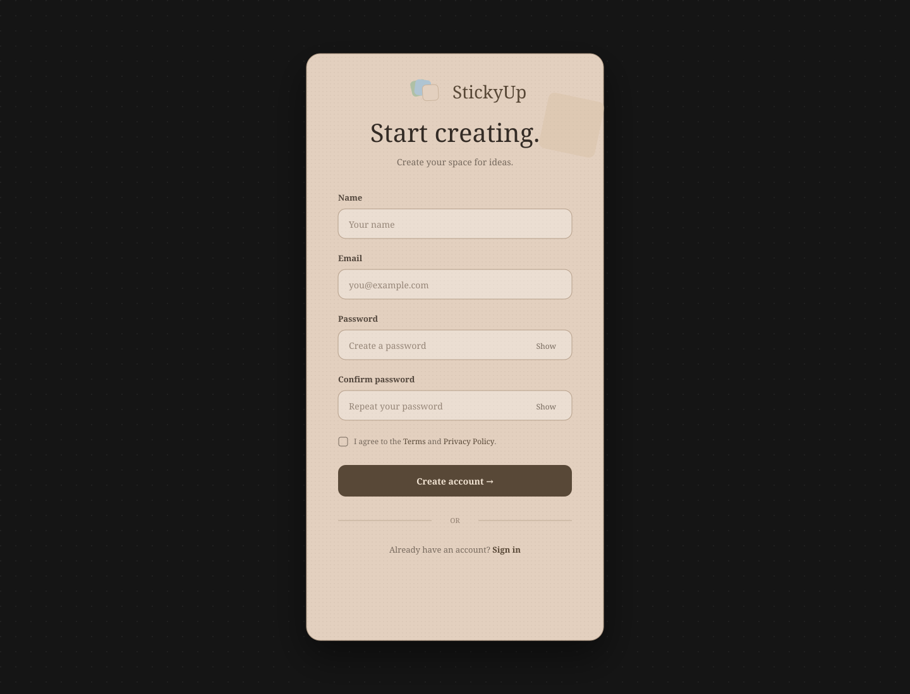
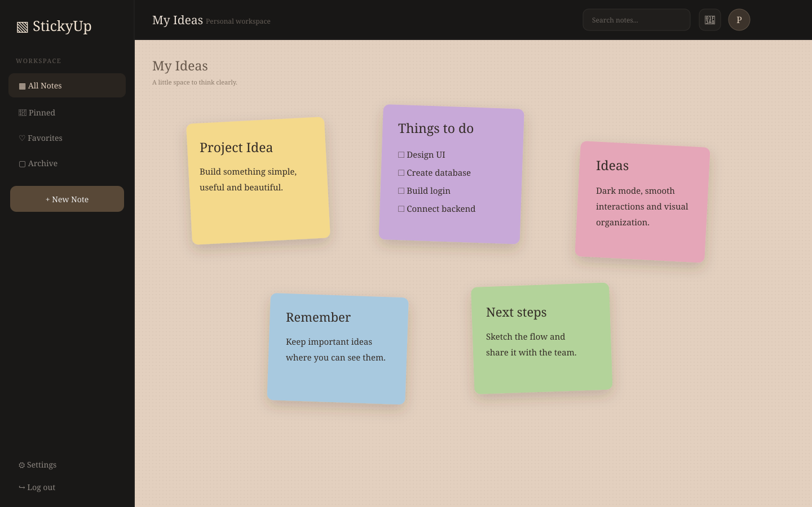
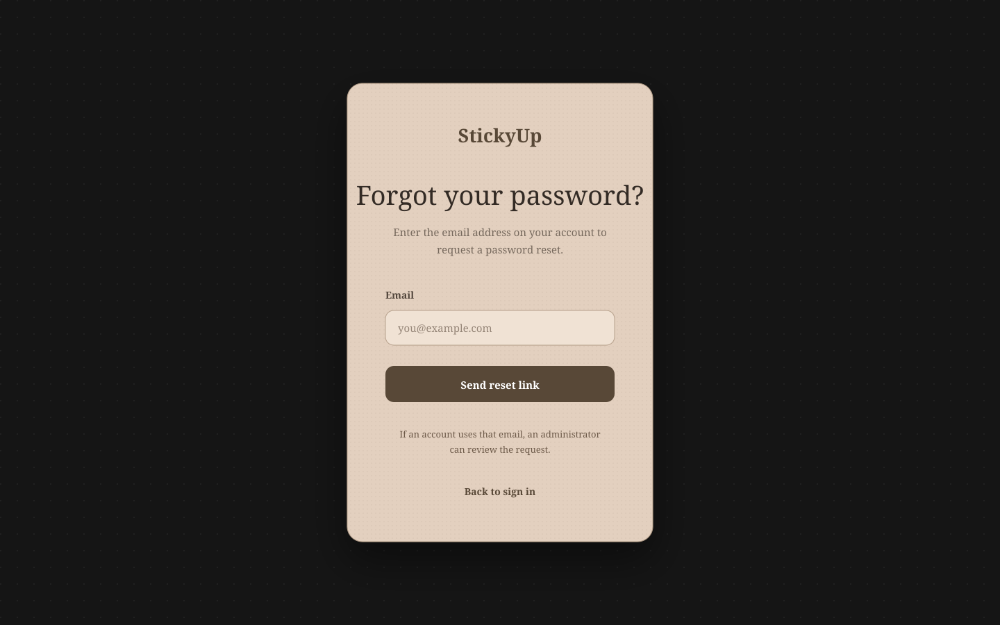

# StickyUp

StickyUp is a sticky-note workspace for capturing, arranging, and organizing ideas. It is a Java web application packaged as a Maven WAR and deployed on Railway.

<p align="center">
  
</p>

## Project Links

- **Live Application:** https://stickyup-production-2dffdb9c.up.railway.app/
- **GitHub Repository:** https://github.com/parth-joisar/StickyUp

## Features

- Create an account and sign in.
- Access a personal notes workspace.
- Create, view, edit, and delete notes.
- Browse the interactive landing-page demo.
- Request a password reset.

## Technologies and Tools

| Category | Technology |
|---|---|
| Programming language | Java 17 |
| Build and dependency management | Apache Maven |
| Application framework | Spring MVC 6 |
| ORM and persistence | Hibernate 6, Jakarta Persistence |
| Database | MySQL |
| Web server / servlet container | Apache Tomcat 10.1 |
| Servlet API | Jakarta Servlet 6 |
| Deployment | Railway |
| Source-code hosting | Git and GitHub |
| Container configuration | Docker |

## Repository Structure

```text
StickyUp/
├── Documents/                  Setup and deployment guides
├── Implementation/
│   └── StickyUpMaven/           Java web app, Maven, Docker, and Railway files
├── Screenshots/                 Application previews
└── README.md
```

## Application Screenshots

The repository includes desktop previews of the main application pages.

<details>
<summary>Landing page</summary>


</details>

<details>
<summary>Sign-in page</summary>


</details>

<details>
<summary>Account creation page</summary>



</details>

<details>
<summary>Workspace</summary>



</details>

<details>
<summary>Password reset request</summary>



</details>

> These repository images are page previews. For project evaluation, use screenshots captured from the running application to demonstrate working functionality.

## Installation and Execution

### Prerequisites

Install the following before running StickyUp locally:

- JDK 17
- Apache Maven
- MySQL Server
- Apache Tomcat 10.1

### 1. Clone the repository

```bash
git clone https://github.com/parth-joisar/StickyUp.git
cd StickyUp/Implementation/StickyUpMaven
```

### 2. Configure the database

Create the local database and database user using:

```text
database-setup.sql
```

For additional database setup details, see [`Documents/DATABASE-SETUP.txt`](../../Documents/DATABASE-SETUP.txt) from the repository root.

### 3. Configure database connection

The default local database settings are defined in:

```text
src/main/resources/hibernate.cfg.xml
```

You can override the connection settings with environment variables:

- `DB_URL`, or
- `DB_HOST`, `DB_PORT`, and `DB_NAME`
- `DB_USER`
- `DB_PASSWORD`

Set these variables to match your local MySQL configuration. Do not commit real database passwords or other secrets to GitHub.

### 4. Build the application

From the `Implementation/StickyUpMaven` directory, run:

```bash
mvn clean package
```

Maven creates the WAR file at:

```text
target/StickyUp.war
```

### 5. Run using Tomcat

Deploy `target/StickyUp.war` to Apache Tomcat 10.1 and start the server. Open the Tomcat application address in a browser to access StickyUp.

## Database Setup

StickyUp uses MySQL for persistent application data and Hibernate for object-relational mapping.

1. Start the MySQL server.
2. Run `Implementation/StickyUpMaven/database-setup.sql`.
3. Configure the database connection using the environment variables described above, or the local settings in `hibernate.cfg.xml`.
4. Build and run the application.

For the project's additional database notes, see [`Documents/DATABASE-SETUP.txt`](Documents/DATABASE-SETUP.txt).

## Deployment

The application is deployed on Railway:

**Live URL:** https://stickyup-production-2dffdb9c.up.railway.app/

For deployment configuration and instructions, see [`Documents/DEPLOY-RAILWAY.md`](Documents/DEPLOY-RAILWAY.md).

## Source Code

The complete source code is available in the GitHub repository:

https://github.com/parth-joisar/StickyUp

## Security Note

The current account implementation stores passwords as plain text. This project is suitable for development and academic demonstration only until password hashing is implemented. Do not use real user accounts or real passwords with this application.

Never publish production database credentials, API keys, or other secrets in the repository. Configure sensitive values through environment variables in the deployment environment.

## Academic Project

**Project:** StickyUp  
**Course:** 01CE0308 – Advance Java Technology  
**Department:** Computer Science Engineering  
**Institution:** Marwadi University
