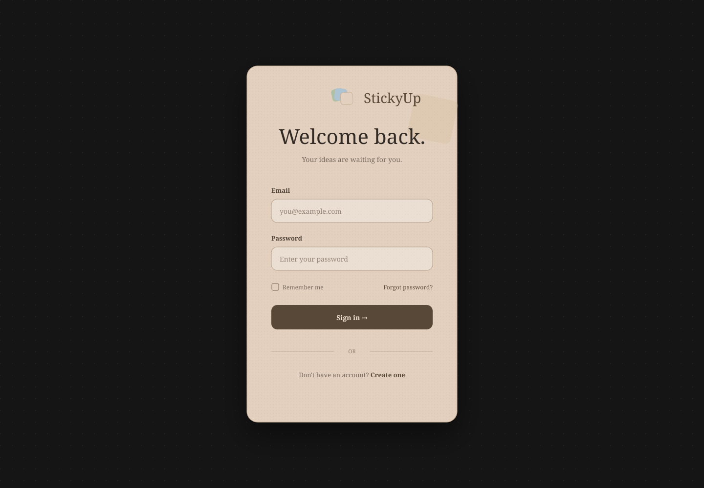

# StickyUp

StickyUp is a sticky-note workspace for capturing, arranging, and organizing ideas. The project is a Java web application packaged as a Maven WAR.

## Features

- Create an account and sign in
- Organize notes in a workspace
- Browse the interactive landing-page demo

## Repository structure

```text
StickyUp/
├── Documents/                  Setup and deployment guides
├── Implementation/
│   └── StickyUpMaven/           Java web app, Maven, Docker, and Railway files
├── Screenshots/                 Full-page desktop page previews
└── README.md
```

## Desktop page previews

<details>
<summary>Landing page</summary>


</details>

<details>
<summary>Sign-in page</summary>



</details>

<details>
<summary>Account creation page</summary>


</details>

## Technology

- Java 17
- Maven WAR packaging
- Spring MVC 6
- Hibernate 6 and Jakarta Persistence
- MySQL
- Tomcat 10.1 / Jakarta Servlet 6

## Run locally

1. Install JDK 17, Maven, and MySQL Server.
2. Create the local database and user using [`Implementation/StickyUpMaven/database-setup.sql`](Implementation/StickyUpMaven/database-setup.sql). See [`Documents/DATABASE-SETUP.txt`](Documents/DATABASE-SETUP.txt) for details.
3. The default local database settings are in `Implementation/StickyUpMaven/src/main/resources/hibernate.cfg.xml`. Set `DB_URL`, or `DB_HOST`, `DB_PORT`, and `DB_NAME`, plus `DB_USER` and `DB_PASSWORD`, to override them.
4. Build the WAR from the project folder:

   ```bash
   cd Implementation/StickyUpMaven
   mvn clean package
   ```

5. Deploy `Implementation/StickyUpMaven/target/StickyUp.war` to Tomcat 10.1. Open the Tomcat address in a browser and choose **Start creating**.

## Deployment

See [`Documents/DEPLOY-RAILWAY.md`](Documents/DEPLOY-RAILWAY.md) for Railway setup instructions.

## Security note

The current account implementation stores passwords as plain text. This project is suitable for development and demonstration only until password hashing is implemented. Do not use real user accounts or real passwords with it.
